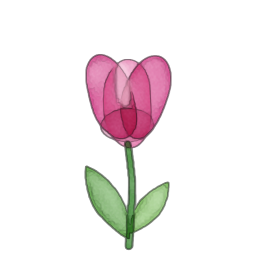
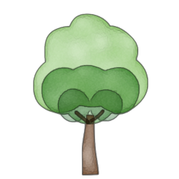
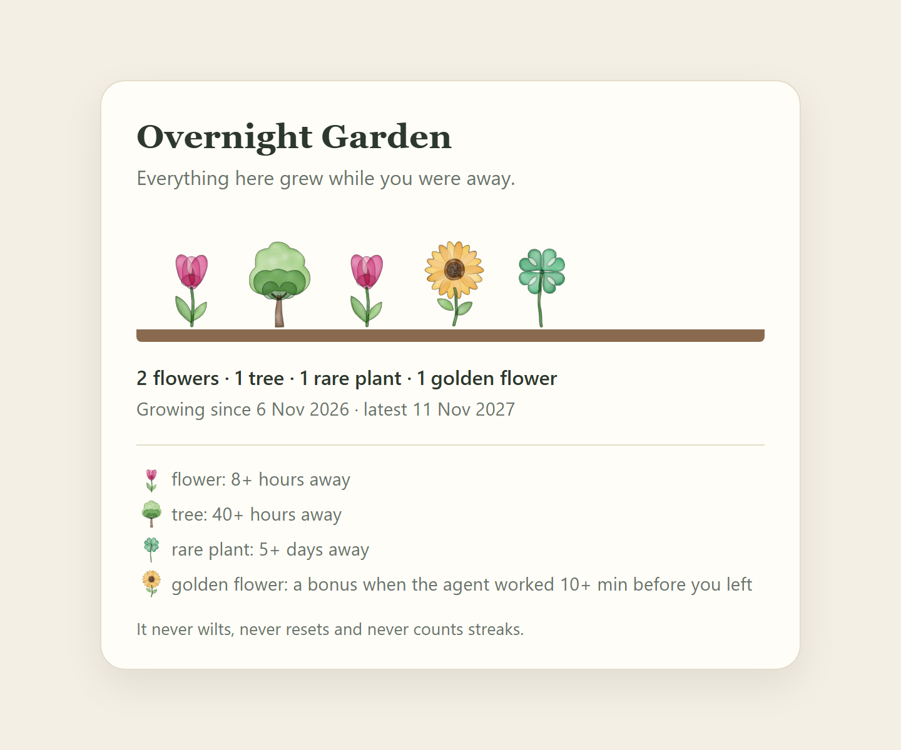

# Overnight Garden

[](https://github.com/har27il/overnight-garden/actions/workflows/ci.yml)

**It only grows while you're gone.** Overnight Garden is a small watercolor garden in your Claude Code status line, and it grows only while you're away.

```
🌱 Overnight Garden · 🌷 2  🌳 1  🍀 1  🌻 1
```

<p align="center">
  
  
  
  
</p>

## In short

- **Who it's for.** It's for people who work with Claude Code every day. In particular, anyone who hands a long task to an agent and then feels they ought to watch it, or slips in one more prompt before bed.
- **The problem: compression burnout.** Agents compress weeks of work into hours, and rest gets compressed along with it. It shows up as:
  - a check-in at midnight;
  - a weekend that blurs into the week;
  - the feeling that because the machine is working, you should be too.
- **How it gives time back.** The only thing that grows the garden is stepping away:
  - a night off grows a flower;
  - a weekend grows a tree;
  - a real break grows a rare plant;
  - handing off a long task before you go adds a golden flower.

  Once it's installed there's nothing to do: nothing to check, tend or log.
- **What it never does.**
  - It sends no notifications, prompts or questions.
  - It keeps no streaks, and doesn't track you.
  - It never wilts, never resets, and never adds text to your conversations.

  It keeps three times on your own computer: when you were last here, when you last sent a prompt, and when the agent last stopped. It never stores what you wrote, and it sends nothing anywhere.

## Quick start

```bash
git clone https://github.com/har27il/overnight-garden.git
cd overnight-garden
node scripts/install.js
```

Restart Claude Code and you'll see `🌱 Overnight Garden · grows while you rest` at the bottom. Tonight, just stop working; tomorrow morning there's a flower.

You need [Claude Code](https://claude.com/claude-code) and [Node.js](https://nodejs.org) 20 or newer. Nothing else gets installed, and nothing uses the network.

To remove it, run `node scripts/uninstall.js`. Your settings come back exactly as they were.

## What grows

| Time away | What grows |
|---|---|
| 8+ hours (a night) | 🌷 a flower |
| 40+ hours (a weekend) | 🌳 a tree |
| 5+ days (a real break) | 🍀 a rare plant |
| Any 8+ hours, if the agent kept working on your last prompt after you left, for 10+ minutes in all | 🌻 a golden flower as a bonus: hand off the work, then rest |

- **Only time away grows anything.** Working more never earns a plant, and short breaks grow nothing.
- **Plants are only ever added.** A month off is rewarded, never punished.

## Evidence that it works

- **CI.** On every push, [GitHub Actions](.github/workflows/ci.yml) runs the full test suite and `demo.sh` on Linux, macOS and Windows, with Node.js 20 and 24. It also checks the demo prints exactly what's in [`demo-output.txt`](demo-output.txt). The badge at the top shows the latest result.
- **The demo's real output** is saved in [`demo-output.txt`](demo-output.txt) and shown below.
- **The tests read like the rules they check.** For example: "never wilts: a garden left alone for a year keeps every plant", and "no alerts or prompts: every hook call prints nothing and exits 0, adding nothing to the conversation". Run `npm test` to see them all.
- **The garden card** is pictured further down.

### Run the demo yourself

```bash
./demo.sh
```

On Windows PowerShell, use `node scripts/demo.js` instead.

The demo installs Overnight Garden into a throwaway home folder. It plays out a weekday night, a lunch break, a weekend, a long agent handoff and a year left alone. Then it uninstalls and checks your settings came back byte for byte. Every line it prints is a check:

```
PASS install: settings backed up first, then 3 hooks and the status line added; your own settings kept
PASS weekday night: away 9 hours (Thu 22:00 → Fri 07:00) → grew 🌷 flower
PASS lunch break: away 1 hour (Fri 12:00 → Fri 13:00) → nothing grew, and nothing was lost
PASS weekend: away 63 hours (Fri 18:00 → Mon 09:00) → grew 🌳 tree
PASS long agent handoff: away 9 hours (Mon 23:00 → Tue 08:00), the agent worked 45 minutes first → grew 🌷 flower + 🌻 golden flower
PASS a year left alone: away 365 days (10 Nov 2026 → 11 Nov 2027) → grew 🍀 rare plant
PASS never wilts or resets: after a year away, all 5 plants are still there, in the order they grew
PASS no alerts: all 19 hook calls printed nothing and exited 0, so nothing was added to the conversation
PASS status line shows: 🌱 Overnight Garden · 🌷 2  🌳 1  🍀 1  🌻 1
PASS garden card: saved with all 5 plants as watercolor paintings, and when each one grew
PASS uninstall: settings are byte-for-byte what they were before install, and the garden is kept
PASS all 11 checks passed; throwaway home removed
```

### What's real vs simulated

**Real:**
- `scripts/install.js` really edits a `settings.json`, backing it up first.
- Each hook runs as the exact command the install wrote, in a shell, with the kind of JSON Claude Code sends.
- The engine, garden file, status line, card and uninstall are the same code you install.

**Simulated:**
- **The clock.** Each hook call is told the time, in milliseconds, through `OVERNIGHT_GARDEN_NOW`, so a year passes in seconds. Nothing is told what to grow or print; the real rules decide.
- **Claude Code itself.** The demo and tests send the events Claude Code would send. They don't start a live Claude Code session.
- **Your home folder.** Everything happens in a throwaway folder, so your real `~/.claude` is never touched.

## See your garden card

```bash
node scripts/card.js
```

This saves a small web page of your garden and prints its address. Open it in your browser to see every plant, painted in watercolor, and when each one grew:



## The paintings

The four plant paintings are original artwork, painted in code with [OpenCV](https://opencv.org) by `tools/paint_plants.py`:
- **Drawing:** each plant is built from simple shapes.
- **Washes:** each shape is laid down like a watercolor wash, with wobbly edges, uneven pigment that dries darker at the rim, and paper grain.
- **Glazing:** the washes layer like tinted glass.
- **Highlights:** highlights are lifted back out, as a damp brush would.
- **Softening:** OpenCV's watercolor filter (`stylization`) softens the result.

Every random choice is seeded, so painting again gives exactly the same pictures. You don't need Python to use the garden, because the paintings come ready in `assets/plants/`. To repaint them yourself:

```bash
pip install opencv-python numpy
python tools/paint_plants.py
```

## Uninstall

```bash
node scripts/uninstall.js
```

This puts your settings back exactly as they were before you installed. If you changed other settings in the meantime, those changes are kept and only the garden's lines are removed. Your garden stays in `~/.claude/overnight-garden/` in case you come back. Delete that folder to remove it completely.

## How it works

- **Hooks.** Sending a prompt (`UserPromptSubmit`) or opening a session (`SessionStart`) means you're here. `Stop` means the agent finished its turn. When you come back after time away, the engine works out what grew and saves it.
- **Measuring time away.** "Away" runs from your last prompt, in any Claude Code window, to when you're back. Sessions that start because the agent's context was compacted don't count as you being back.
- **The golden flower.** It counts only the agent's turn on your last prompt, in that same window, and only if the agent was still working after you were last here.
- **Files.** Everything lives in `~/.claude/overnight-garden/`:
  - `garden.json`: your plants.
  - `presence.json`: the three times above.
  - `card.html`: your garden card.
  - The settings backup, while installed.
- **Staying silent.** The hooks always print nothing and exit cleanly, even if something goes wrong. The status line and card only ever show known plant types, never text from the garden file.

| File | What it does |
|---|---|
| `src/engine.js` | The rules: what one absence grows. It never reads the clock; every time is passed in, in milliseconds. |
| `src/store.js` | Loads and saves the garden. It only ever adds plants, and never overwrites a file it can't read. |
| `src/presence.js` | Tracks when you were last here and turns a return into an absence. |
| `src/overnight-garden-hook.js` | The hook Claude Code runs. |
| `src/overnight-garden-statusline.js` | The status line Claude Code runs. |
| `src/render.js` | The status line text and the garden card. Shows only known plant types and the dates it formats itself. |
| `src/settings.js` | Install and uninstall, with the backup. |
| `scripts/` | The install, uninstall, card and demo commands. |
| `tools/paint_plants.py`, `assets/plants/` | Paints the watercolor plants with OpenCV, and the paintings it made. |

## Run the tests

```bash
npm test
```

The tests only ever use throwaway home folders, never your real `~/.claude`.

## Limitations

- **Not yet run inside a live Claude Code session.** The automated runs send Claude Code's documented hook input (`session_id`, and `source` for SessionStart) instead. If a future version sends something different, the hook stays silent and that night simply doesn't grow.
- **Time away is counted from your last prompt or session start.** Reading the agent's answer for an hour before leaving counts as away.
- **Automated `claude -p` runs** fire the same hooks as you do, such as a nightly job, so they count as you being here.
- **Claude Code shows one status line.** If you already have one, it's put aside while the garden is installed and comes back on uninstall.
- **The hooks run from the folder you cloned**, so keep it where it is. A folder path containing `"`, `$` or a backtick would break the installed commands.
- **There's one garden per computer account**, shared by every Claude Code window. Two windows' hooks firing in the very same instant could undo each other's last update.
- **The paintings are made once and committed.** CI doesn't repaint them, because a different OpenCV version could shift pixels.

## License

MIT. See [LICENSE](LICENSE).
